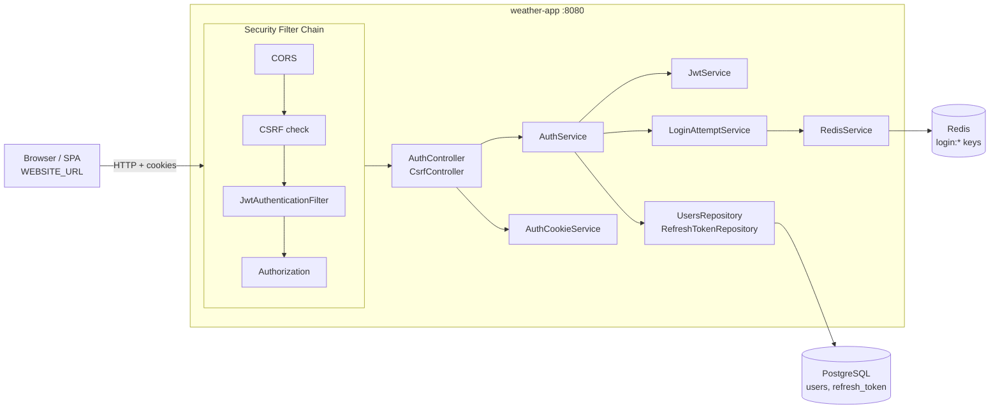
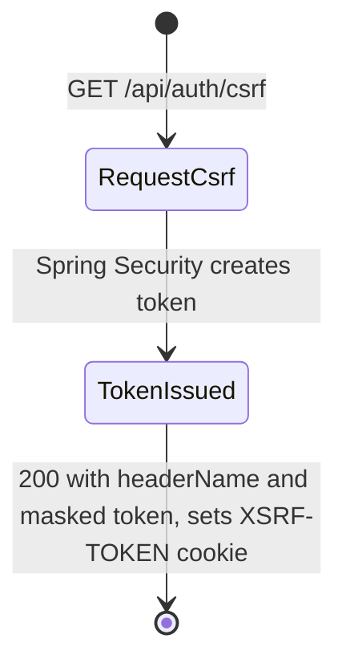
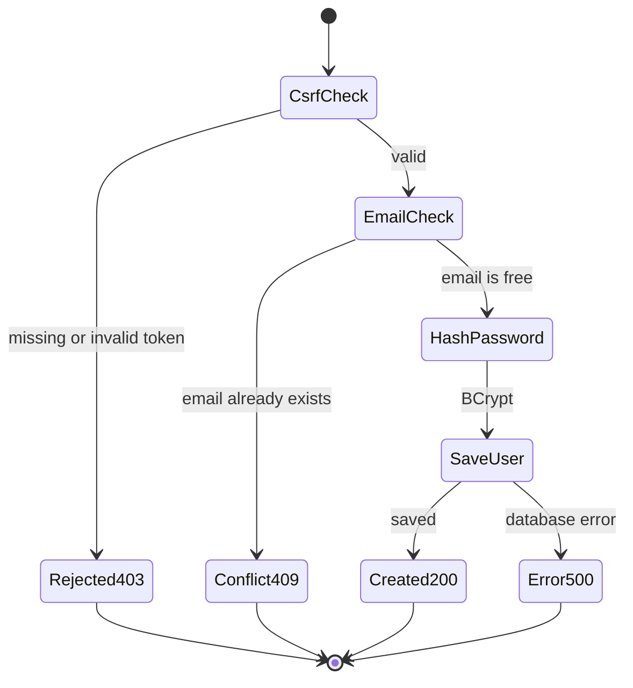
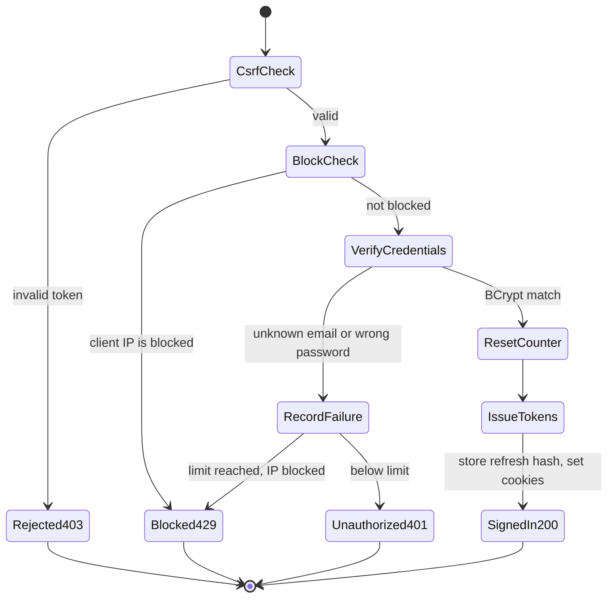
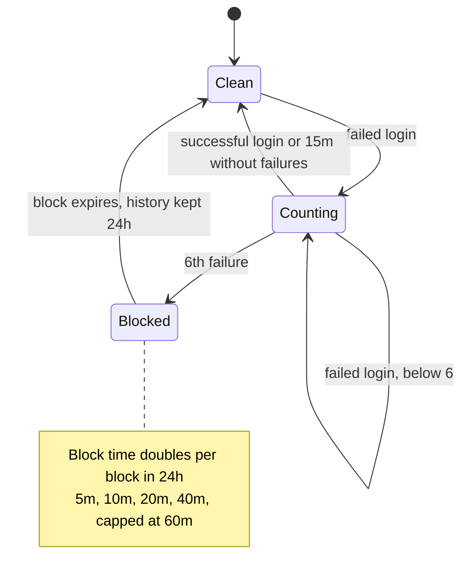
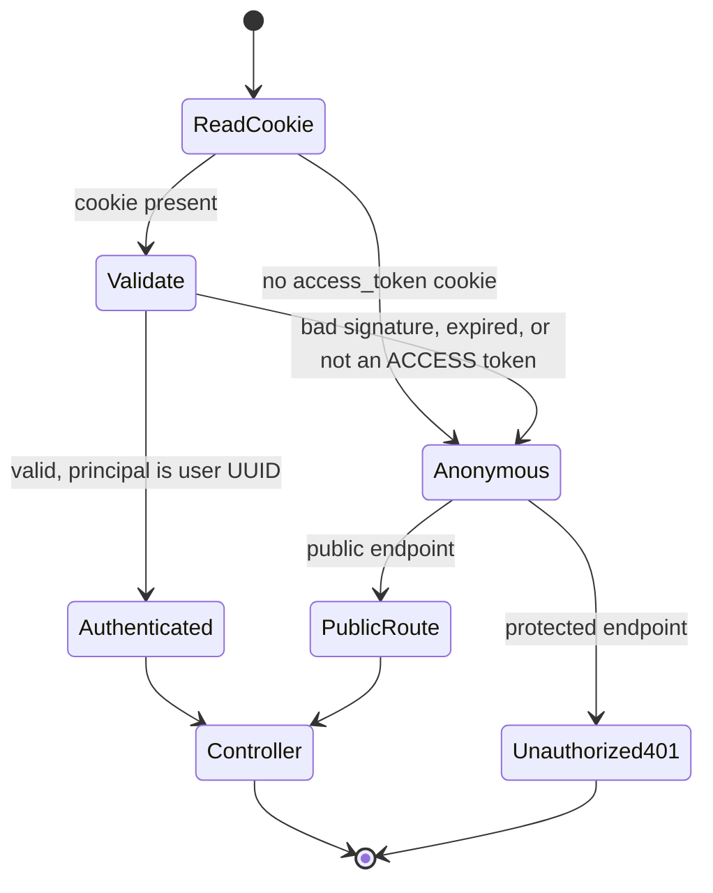
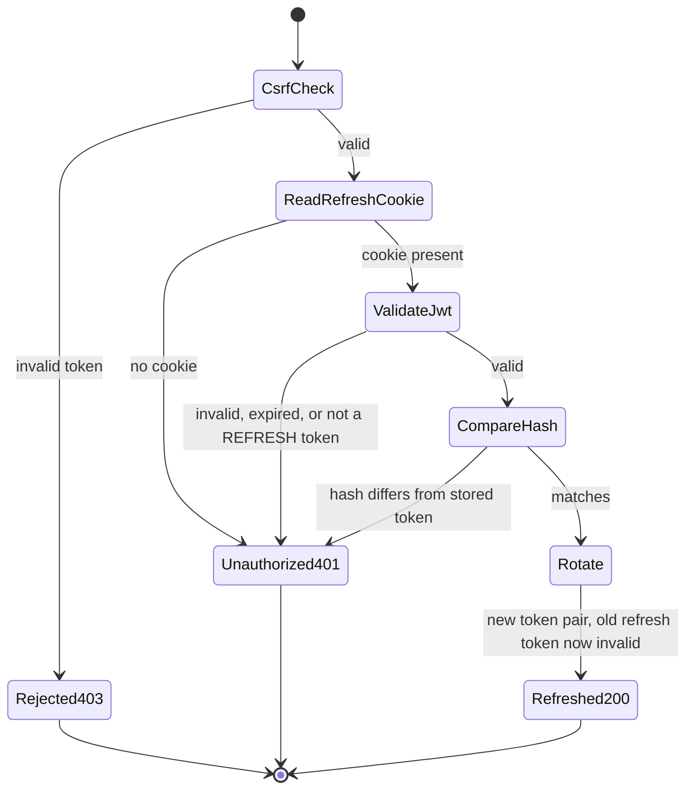
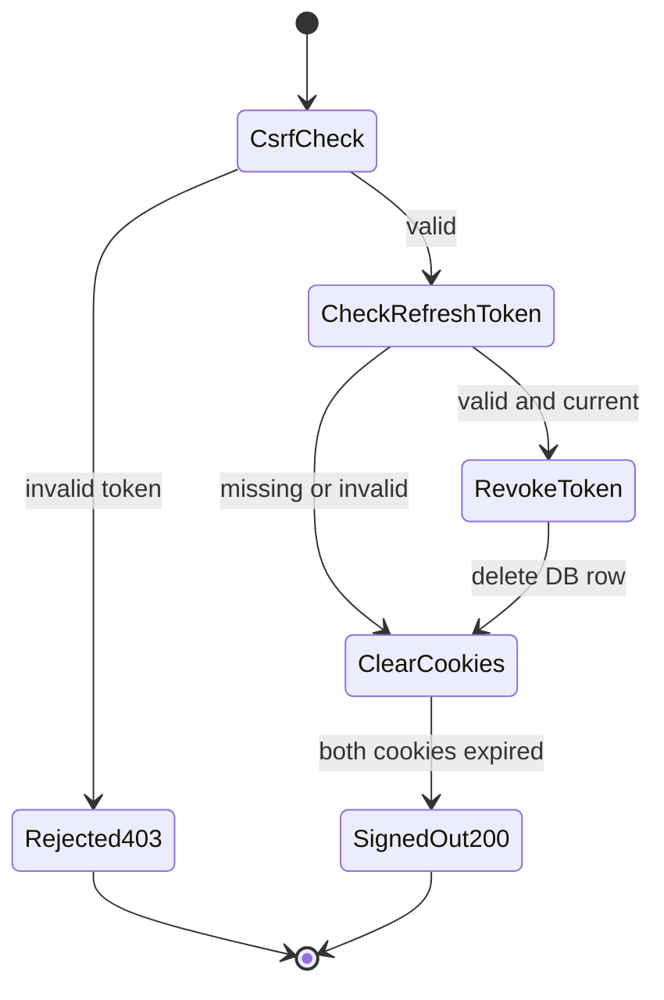

# Weather App — Backend

Backend for a weather application. The **authentication system** is the part implemented so far: sign up, sign in, cookie-based JWT authentication, token refresh with rotation, sign out, CSRF protection and brute-force protection.

## Tech Stack

| Technology | Role |
|---|---|
| Java 17 · Spring Boot 4.1 | Application framework (Spring Web MVC) |
| Spring Security | Filter chain, CSRF, CORS, authorization |
| JJWT 0.13 | Signing and validating JWTs (HS256) |
| Spring Data JPA · PostgreSQL 17 | Users and refresh tokens |
| Spring Data Redis · Redis 7.4 | Failed-login counters and IP blocks |
| BCrypt | Password hashing |
| Docker · Docker Compose | Multi-stage image and local stack |
| Maven · Lombok | Build and boilerplate reduction |

---

## Architecture

Layered Spring Boot app: **Controller → Service → Repository**. Every request first goes through the Spring Security filter chain. PostgreSQL holds persistent data. Redis holds short-lived rate-limit state.



| Component | Responsibility |
|---|---|
| `SecurityConfig` | Stateless filter chain, CSRF, public routes, 401 entry point |
| `JwtAuthenticationFilter` | Reads the `access_token` cookie and sets the user ID (`UUID`) as the principal |
| `AuthService` | Sign up, sign in, refresh, sign out |
| `JwtService` | Creates and validates `ACCESS` / `REFRESH` tokens |
| `AuthCookieService` | Writes, reads and clears the HttpOnly token cookies |
| `LoginAttemptService` | Per-IP failed-login counting and progressive blocking |
| `RedisService` | Redis wrapper, including an atomic `INCR` + `PEXPIRE` Lua script |

---

## Authentication Flows

> Every `POST` endpoint requires a valid CSRF token (`X-XSRF-TOKEN` header + `XSRF-TOKEN` cookie). Without one, the request is rejected with **403** before it reaches a controller.

### 1. CSRF Token Bootstrap — `GET /api/auth/csrf`



The cookie is HttpOnly, so the frontend reads the (BREACH-masked) token from the response body and sends it in the `X-XSRF-TOKEN` header.

### 2. Sign Up — `POST /api/auth/sign-up`



Sign up does **not** sign the user in. No tokens are issued.

### 3. Sign In — `POST /api/auth/sign-in`



- Unknown email and wrong password return the same `401` response.
- `IssueTokens` creates an access token and a refresh token. Only the refresh token's **SHA-256 hash** is saved, replacing any earlier one for that user.

### 4. Brute-Force Protection (per client IP, Redis)



| Redis key | Meaning | TTL |
|---|---|---|
| `login:attempts:<ip>` | Failed-attempt counter | 15m after last failure |
| `login:block:<ip>` | Active block | Block duration |
| `login:block-history:<ip>` | Block count used for escalation | 24h after last block |

### 5. JWT Request Authentication (every request)



An invalid token is ignored instead of rejected, so public endpoints like `/refresh` still work when the access token has expired. No protected business endpoints exist yet; every non-public route already requires authentication.

### 6. Token Refresh — `POST /api/auth/refresh`



### 7. Sign Out — `POST /api/auth/sign-out`



Sign out always succeeds and clears the cookies. The access token is stateless, so it is not revoked on the server and stays valid until it expires (max 15m).

---

## Security

| Mechanism | Implementation |
|---|---|
| **Token storage** | JWTs live in `HttpOnly` cookies, so JavaScript (and XSS) cannot read them. `Secure` and `SameSite=Lax` are configurable. |
| **Cookie scoping** | `access_token` uses path `/`. `refresh_token` uses path `/api/auth`, so it is never sent with regular API calls. |
| **Token types** | A `token_type` claim (`ACCESS` / `REFRESH`). Each one is rejected where the other is expected. |
| **Lifetimes** | Access 15 minutes, refresh 14 days. HS256 secret of at least 32 characters, checked at startup. |
| **Refresh rotation** | One stored refresh token per user. Every sign-in or refresh replaces it, so old tokens stop working. |
| **Hashed refresh tokens** | Only SHA-256 hashes are stored, compared in constant time (`MessageDigest.isEqual`). |
| **Passwords** | BCrypt (salted, checked with `matches()`). |
| **CSRF** | Enabled for all state-changing requests, including sign-in and sign-up, because cookies are sent automatically. |
| **CORS** | Explicit origin allow-list (wildcards rejected at startup), credentials allowed, headers limited to `Content-Type` and `X-XSRF-TOKEN`. |
| **Brute force** | Per-IP counter and progressive blocks in Redis. Uses an atomic Lua script, so concurrent requests cannot skip the limit. |
| **IP source** | Uses `getRemoteAddr()`, not a raw `X-Forwarded-For`, so clients cannot forge their IP. |
| **Stateless** | No HTTP session. Form login, HTTP Basic and default logout are disabled. Unauthenticated requests get `401`. |
| **Secret hygiene** | `JwtProperties.toString()` masks the secret. `.env` is excluded from Git and from the Docker image. |

**Design decision:** a user can have only one active refresh token (`@OneToOne`), so signing in on a new device ends the refresh session on the previous one.

---

## Docker & Infrastructure

| Service | Image | Network alias | Host port | Notes |
|---|---|---|---|---|
| `weather-app` | built from `Dockerfile` | — | `8080` | Starts only after Postgres and Redis report healthy and `postgres-init` succeeds; runs with the `local` profile |
| `postgres` | `postgres:17-alpine` | `weather-postgres` | not exposed | Database `${DATABASE_NAME}`, volume `postgres-data`, `pg_isready` healthcheck |
| `postgres-init` | `postgres:17-alpine` | — | — | One-shot job: creates `${DATABASE_NAME}` if missing (idempotent, also for existing volumes) |
| `redis` | `redis:7.4-alpine` | `redis-cache` | not exposed | `--requirepass`, AOF persistence, volume `redis-data`, healthcheck requires `PONG` |

**Dockerfile:** multi-stage build. A JDK 17 stage builds the jar with a Maven cache mount. A JRE 17 runtime stage uses the layered jar and runs as a **non-root** `spring` user.

> **Schema:** the JPA entities are the source of truth. Docker Compose activates the `local` profile (`application-local.properties`), which sets `spring.jpa.hibernate.ddl-auto=update` so Hibernate creates missing tables, foreign keys and sequences. Without that profile `ddl-auto=none`, so production never changes the schema automatically.

---

## API Endpoints

Base path: `/api/auth`. All endpoints are public at the security layer. All `POST` requests need the CSRF header.

| Method | Path | Body | Description | Responses |
|---|---|---|---|---|
| `GET` | `/csrf` | — | Returns `{ headerName, token }` and sets the `XSRF-TOKEN` cookie | `200` |
| `POST` | `/sign-up` | `{ email, password }` | Creates a user with a BCrypt-hashed password | `200`, `409`, `500` |
| `POST` | `/sign-in` | `{ email, password }` | Sets the `access_token` and `refresh_token` cookies | `200`, `401`, `429` |
| `POST` | `/refresh` | — (cookie) | Rotates the token pair | `200`, `401` |
| `POST` | `/sign-out` | — (cookie) | Revokes the refresh token and clears the cookies | `200` |

Any `POST` without a valid CSRF token returns `403`.

### Weather — `/api/weather` (public, `GET` only)

| Path | Params | Description | Cache |
|---|---|---|---|
| `/coordinates` | `lat`, `lon`, `refresh` (optional) | Current weather + forecast for the visitor's location. `refresh=true` replaces the cached location | `weather:session:{sessionId}` |
| `/city` | `name`, `country` (ISO 3166 alpha-2) | Resolves the city with OpenWeather Geocoding, then returns its weather | `weather:city:{lat,lon}` (shared) |
| `/locations` | `query` (min 2 chars) | Up to 5 `{ name, country }` prefix matches (Open-Meteo Geocoding) | `weather:locations:{prefix}` (24h) |

Weather entries expire at the **next full hour in the location's timezone**. Every visitor gets a random `weather_session` cookie (HttpOnly, 30 days). It only keys the personal weather cache, is independent of the JWTs and CSRF token, and is not changed by sign-in or sign-out.

OpenWeather's free plan covers Current Weather, the **5 day / 3 hour** forecast and Geocoding (60 calls/minute). So `hourly` uses 3-hour steps and `daily` covers about 5 days, aggregated from those steps.

---

## How to Run

**1. Create `.env`** in the project root, next to `docker-compose.yml`:

| Variable | Purpose |
|---|---|
| `JWT_SECRET` | HS256 signing secret, at least 32 characters |
| `DATABASE_HOST` | `weather-postgres` |
| `DATABASE_PORT` | `5432` |
| `DATABASE_NAME` | Database name, e.g. `weatherdb` (also used to initialize the container) |
| `DATABASE_USERNAME` | PostgreSQL user (also used to initialize the container) |
| `DATABASE_PASSWORD` | PostgreSQL password |
| `REDIS_HOST` | `redis-cache` |
| `REDIS_PORT` | `6379` |
| `REDIS_PASSWORD` | Redis password (also passed to `--requirepass`) |
| `OPEN_WEATHER_API` | OpenWeather API key (free plan). Used server-side only |
| `WEBSITE_URL` | Frontend origin allowed by CORS, e.g. `http://localhost:3000` (no wildcards) |

**2. Start the stack:**

```bash
docker compose up -d --build      # build and start all services
docker compose ps                 # check health status
docker compose logs -f weather-app
docker compose down               # stop (data volumes kept)
docker compose down -v            # stop and delete Postgres/Redis data
```

The API is available at `http://localhost:8080`. The only allowed frontend origin is the one in `WEBSITE_URL` (bound to `security.cors.allowed-origins`).
