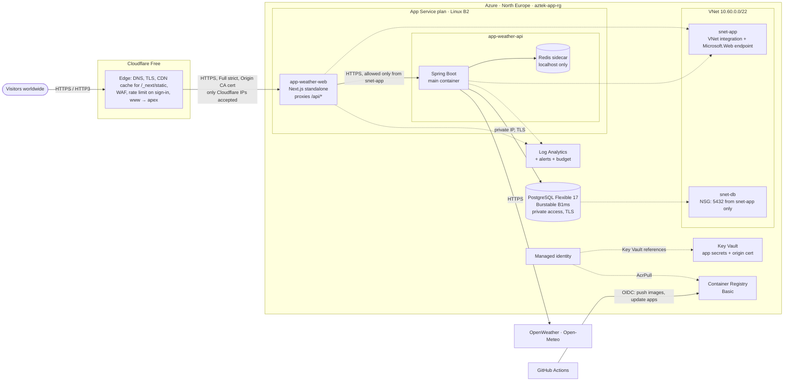

# Azure deployment — michael-site.com

The Weather App (Next.js 16 frontend, Spring Boot backend, PostgreSQL, Redis) runs on **Azure App Service in North
Europe** behind the **Cloudflare Free** CDN, provisioned with **Terraform** and deployed by **GitHub Actions**.

| | |
|---|---|
| Public URL | https://michael-site.com (`www.` redirects to it) |
| Azure | Subscription for Exercise 2 · resource group `aztek-app-rg` · region `northeurope` |
| Terraform state | `terraform-state-rg` (storage account, Entra ID auth only) |
| Estimated cost | **≈ $36.80 / month ≈ $1.21 / day** at low traffic (details below) |

## Architecture



Request path: browser → Cloudflare edge → **web app** (only reachable from Cloudflare's IP ranges) → `/api/*` is forwarded
by `frontend/src/proxy.js` to the **api app** (only reachable from the web app's subnet) → PostgreSQL over the private
network and Redis on `localhost`. The browser only ever talks to `https://michael-site.com` (same origin): no CORS, the
`HttpOnly; Secure; SameSite=Lax` JWT cookies and the CSRF token work unchanged, and the backend has no public endpoint.

## Deployed resources

Resource group `aztek-app-rg` (North Europe), all created by Terraform (`infra/terraform`, 55 Terraform resources,
including role assignments, secrets, subnets and bindings that are not separate Azure resources):

| Service | Name | SKU / role |
|---|---|---|
| App Service plan | `asp-weather-prod-neu` | Linux B2 (2 vCPU, 3.5 GB) |
| Web app (frontend) | `app-weather-web-prod-c66006` | Next.js container, custom domain `michael-site.com` |
| Web app (backend) | `app-weather-api-prod-c66006` | Spring Boot container + Redis sidecar, private |
| PostgreSQL Flexible Server | `psql-weather-prod-neu-c66006` | PostgreSQL 17, Burstable B1ms, 32 GiB, private, database `weatherdb` |
| Container Registry | `acrweatherprodc66006` | Basic; images `weather-web`, `weather-api`, `weather-redis` |
| Key Vault | `kv-weather-prod-c66006` | Standard, RBAC; 4 app secrets + origin certificate |
| App Service certificate | `cloudflare-origin-michael-site-com` | imported from Key Vault |
| Virtual network | `vnet-weather-prod-neu` | `snet-app` (App Service integration), `snet-db` (PostgreSQL) + 2 NSGs |
| Private DNS zone | `weather-prod-neu.private.postgres.database.azure.com` | linked to the VNet |
| Managed identities | `id-weather-prod-neu-apps`, `id-weather-prod-neu-github` | runtime (AcrPull, Key Vault Secrets User) / CI (AcrPush, Website Contributor) |
| Log Analytics | `log-weather-prod-neu` | 30 days, 0.15 GB/day cap |
| Monitoring | `ag-weather-prod-neu` + 6 metric alerts + budget `budget-weather-prod-neu` ($45) | e-mail notifications |

Terraform state: storage account `sttfstate523e7957ec` in `terraform-state-rg` (container `tfstate`).

## Why this architecture

Three PaaS designs were compared (prices verified with the Azure Retail Prices API, North Europe, 730 h/month):

| | **A. App Service B1 (chosen)** | B. Container Apps + VNet | C. Container Apps, no VNet |
|---|---|---|---|
| Compute | 1 plan B1 (1 vCPU, 1.75 GB) for both apps: **$13.14** | 3 apps, min 1 replica (1 vCPU / 2 GiB total), mostly idle: **≈ $22–30** | ≈ $22–30 |
| Private network for PostgreSQL | VNet integration: **free** | Managed load balancer **$18.25** + 2 static IPs **$7.30** | none: DB needs a public endpoint |
| Total / month (low traffic) | **≈ $36.80** | ≈ $71–76 | ≈ $45–50 |
| Backend exposure | access restriction: web-app subnet only | internal ingress | internal ingress |
| Deployments | API restart ≈ 20–40 s (Basic has no slots) | zero-downtime revisions | zero-downtime revisions |
| Scaling / zones | manual 1–3 instances, scale-up; no zones | autoscale, zone redundancy | autoscale, zone redundancy |

**Container Apps** would be the default choice for containers, but keeping PostgreSQL private requires a VNet-integrated
environment, and that adds a Standard Load Balancer and two static public IPs (≈ $25.55/month) on top of compute.
That roughly doubles the bill (this is an MSDN subscription with a spending limit). Dropping the VNet would expose the
database to the internet. **App Service B1** gives private database networking for free, hosts both apps on one plan,
and runs Redis as a sidecar at no extra cost, at the price of a short API restart on deployments and manual scaling.

Also considered: *Static Web Apps* (free tier can't proxy to a private backend), *Azure Managed Redis B0* (+$13.14/month;
the app only uses Redis as a cache and for login counters, so a sidecar is enough), and *code-based App Service
deployments without Docker* (same cost; Docker was kept for identical local/CI/production artifacts).

The plan was later scaled up from B1 to B2 (+$12.41/month), see [Capacity of the B2 plan](#capacity-of-the-b2-plan).

## Region

West Europe and Germany West Central offer **no PostgreSQL Burstable SKUs to this subscription**
(`az postgres flexible-server list-skus`), so they were excluded.

| Region | PostgreSQL B1ms | App Service B1 | Container Apps | Log Analytics /GB | Notes |
|---|---|---|---|---|---|
| **North Europe** | **$0.0180/h** | $0.018/h | base rate | **$2.76** | cheapest; geo-backup to West Europe; existing RG location |
| France Central | $0.0190/h | $0.018/h | base rate | $2.76 | +$0.73/month |
| Sweden Central | $0.0199/h | $0.018/h | base rate | $2.99 | +$1.39/month |
| UK South | $0.0190/h | $0.018/h | +42 % | $2.88 | |
| Norway East, Switzerland North | $0.0219/h | | base rate | | most expensive |
| Italy North, Poland Central, Spain Central | available | | | | no geo-redundant backup |
| West Europe, Germany West Central | **not available** | | | | subscription restriction |

North Europe (Dublin) also has good transatlantic connectivity, which matters because Cloudflare serves the static
assets everywhere and only dynamic requests travel to the origin.

## Monthly cost

Low traffic (≤ ~50k page views and ≤ ~200k API calls per month, database < 1 GB):

| Service | SKU / configuration | USD / month | Source |
|---|---|---:|---|
| App Service plan (Linux) | B2 · 1 instance · 730 h × $0.035 | 25.55 | verified (Retail Prices API) |
| PostgreSQL Flexible Server | Burstable B1ms · 730 h × $0.018 | 13.14 | verified |
| PostgreSQL storage | 32 GiB Premium SSD (P4), auto-grow | ≈ 4.05 | **estimate**: meter not in the API; flexible-server storage rate $0.1265/GB |
| PostgreSQL backups | 7-day PITR + geo-redundant copy | 0.00–0.50 | free up to 100 % of provisioned storage (LRS $0.095/GB verified); geo copy **estimated** |
| Container Registry | Basic (10 GB included) · 30.4 d × $0.1666 | 5.07 | verified |
| Key Vault | Standard · 4 secrets + 1 certificate | ≈ 0.03 | verified ($0.03 / 10k operations) |
| Log Analytics | pay-as-you-go, 30-day retention, cap 0.15 GB/day | 0.00 | first 5 GB/month free; cap keeps ingestion below it |
| Private DNS zone | 1 zone | 0.50 | verified |
| Metric alerts | 6 rules × $0.10 | 0.60 | verified |
| VNet, subnets, NSGs, VNet integration, service endpoints | | 0.00 | free (Microsoft docs) |
| Budget, action group e-mails | | 0.00 | free |
| Terraform state | Storage LRS, < 1 MB | ≈ 0.02 | verified ($0.022/GB) |
| Outbound data | first 100 GB/month free | 0.00 | |
| Cloudflare | Free plan | 0.00 | |
| **Total** | | **≈ 49.21 / month · ≈ 1.62 / day** (≈ 36.80 with B1) | |

Higher traffic (≈ 500k page views, 2–3M API calls per month):

| Change | USD / month |
|---|---:|
| App Service B2 → B3 (4 vCPU, 7 GB) | +25.55 |
| Log Analytics ~10 GB (cap raised) | +0 to +13.80 |
| PostgreSQL B1ms → B2s, only if CPU credits run out (alert configured) | +39.42 |
| **Total** | **≈ 75 – 89** (≈ 128 with B2s) |

Possible extra charges: outbound data above 100 GB/month ($0.087/GB), Log Analytics above 5 GB, storage auto-grow,
OpenWeather beyond the free plan (1M calls/month, 60/min; the backend caches each city for up to an hour). A resource
group **budget of $45/month** with notifications at 50/80/100 % and a forecast alert guards the spending limit (set
for B1: with B2 the estimate is above it, so the forecast alert is expected to fire).

## Global latency

* **Cloudflare edge** (300+ cities) terminates TLS and HTTP/3 close to the visitor and keeps warm connections to the origin.
* `/_next/static/*` (hashed JS, CSS, fonts; `Cache-Control: public, max-age=31536000, immutable`) is cached at the edge
  for a year, so the heaviest bytes never cross the ocean.
* HTML and `/api/*` are **not cached** (`/api` has an explicit bypass rule and the backend sends
  `Cache-Control: no-cache, no-store`), so personal data and cookies never land in a shared cache.
* The backend answers weather requests from Redis (cached until the next full hour per city/visitor), so origin time
  stays small; the remaining latency is the round trip to Dublin for dynamic requests.
* Rejected for cost: a second region (doubles the bill), Argo Smart Routing ($5/month + $0.10/GB). Possible next step:
  cache the prerendered HTML at the edge with a cache purge in CI (Next.js 16 keys RSC variants with `_rsc`).

## Security

| Layer | Controls |
|---|---|
| Edge | Universal SSL, Always HTTPS, HSTS, TLS ≥ 1.2, managed WAF rules, rate-limit rule on `/api/auth/sign-in`, `x-middleware-rewrite` header stripped |
| Origin | Web app accepts **only Cloudflare IP ranges**; SSL mode Full (strict) with a 15-year Cloudflare Origin CA certificate; HTTPS only; FTP/SCM basic auth disabled; SCM site denied |
| Backend | No public access: App Service access restriction allows only the web app's subnet; HTTPS between the apps |
| Database | VNet-injected (no public endpoint), NSG allows 5432 from `snet-app` only, TLS required (`sslmode=require`), 7-day PITR |
| Secrets | `.env` values live in **Key Vault**; apps resolve them via Key Vault references with a managed identity. Terraform writes them through **write-only attributes** (ephemeral variables), so they never appear in plans or state. Images contain no `.env` (verified by scanning all image files) |
| CI/CD | GitHub OIDC (no stored Azure credentials), identity limited to `AcrPush` + `Website Contributor` on the two apps, actions pinned to commit SHAs |
| Application | HttpOnly/Secure/SameSite cookies, CSRF tokens, BCrypt, login limiter keyed on the **real visitor IP** (`CF-Connecting-IP`; previously all visitors would have shared the proxy's IP), security headers, Redis password (sidecar not reachable from outside the app) |
| Privacy | Data stays in the EU (North Europe, backups in West Europe); the app doesn't log IPs; logs kept 30 days |

Known trade-offs: Key Vault keeps its public endpoint (RBAC-only) because a private endpoint costs $7.30/month; the
backend connects with the PostgreSQL administrator login from `.env` (reused as required) instead of a separate
least-privilege role.

## Capacity of the B2 plan

B2 = 2 vCPUs and 3.5 GB RAM shared by the Next.js container, the Spring Boot container and the Redis sidecar. Measured
locally for B1 sizing, with all three containers pinned to **one shared CPU core**, under a mix of page loads, weather
lookups, autocomplete and wrong-password sign-ins (full BCrypt checks), with keep-alive connections:

| Load | Throughput | p95 latency (weather / sign-in) | Errors | Peak memory (web + api + redis) |
|---|---|---|---|---|
| idle | – | – | – | 50 + 267 + 4 = **321 MiB** |
| 5 clients | 289 req/s | 43 / 54 ms | 0 | 619 MiB |
| 20 clients | 580 req/s | 72 / 85 ms | 0 | 635 MiB |
| 50 clients | 761 req/s (core saturated) | 130 / 172 ms | 0 | **663 MiB** |

The JVM heap is capped at 512 MB (`-Xmx512m`) and Redis at 128 MB, so memory can't exceed ≈ 1 GB, leaving room for the
App Service runtime.

Measured on Azure (request times are server side, from the HTTP logs; from Israel add ≈ 0.15–0.3 s of network):

| | B1 (before) | B2 (now) |
|---|---|---|
| Spring Boot start (`Started WeatherAppApplication in`) | 87–257 s | 28.5–30 s |
| CPU during a backend restart | 99 % for 5+ minutes | 52–80 % for ≈ 1 minute |
| Memory used by the plan | 80–88 % of 1.75 GB | 60–67 % of 3.5 GB |
| First sign-up after a restart | 11.3–16.3 s | 2.7 s |
| Later sign-ups | 0.5–1.1 s, 1.7–4 s while a restart was running | 0.33–0.37 s |

During a restart App Service runs the old and new containers side by side and switches over once the new one answers,
so a backend deployment is not an outage. `-XX:TieredStopAtLevel=1 -XX:+UseSerialGC` (they cut the B1 start from
≈ 4–5 min to ≈ 2 min) and `WEBSITES_CONTAINER_START_TIME_LIMIT=1800` (no kill-and-restart loop) are kept. Next steps if
needed: B3 (+$25.55/month) or P0v3.

## High availability and recovery

What this low-cost deployment provides:

* App Service health checks (`/healthz`, `/actuator/health/readiness`) replace unhealthy instances; *Always On* keeps the
  apps warm; App Service SLA 99.95 %.
* PostgreSQL: automated backups with point-in-time restore for 7 days, plus a geo-redundant copy in West Europe;
  `is_db_alive`, storage and CPU-credit alerts.
* Cloudflare keeps serving cached static assets and shields the origin from traffic spikes and attacks.
* Everything is reproducible: Terraform rebuilds the environment, the state is versioned with 30-day soft delete, and
  `prevent_destroy` protects the database.

Limitations (accepted to stay near $37/month):

| Limitation | Impact |
|---|---|
| One App Service instance in one zone | A host failure or platform maintenance means minutes of downtime until the instance is replaced |
| Basic tier has no deployment slots | Each backend deployment restarts the API for ≈ 20–40 s (frontend ≈ 5 s); API calls fail meanwhile |
| No autoscale on Basic | Traffic surges need a manual scale-up/out |
| PostgreSQL Burstable without HA | Server or zone failure = downtime until Azure recovers it or a restore finishes (RTO hours, RPO ≤ 5 min with PITR) |
| Geo-restore target | West Europe currently offers no Burstable SKU to this subscription: a geo-restore needs a General Purpose SKU or a quota request |
| Redis sidecar per instance | Not replicated; lost on restart (only cache misses and reset login counters); with >1 instance each has its own cache |
| Single region | A North Europe outage takes the site down (only cached static assets remain at Cloudflare) |

A production-grade deployment would add (rough, unverified estimates per month; P0v3 is verified at $0.084/h):

| Change | Gains | ≈ USD/month |
|---|---|---:|
| App Service Premium v3 P0v3 × 2 instances, zone redundant, deployment slots, autoscale | No single host, zero-downtime deploys, automatic scaling | +110 |
| PostgreSQL General Purpose D2ds_v5 with zone-redundant HA | Automatic failover in ≈ 1–2 min | +250 |
| Azure Managed Redis (Balanced B1, HA) instead of the sidecar | Shared, replicated cache and login counters | +50 |
| Private endpoints for Key Vault, ACR (Premium) and the API | No public data-plane endpoints | +70 |
| Second region (active/passive) with read replica and Cloudflare load balancing | Region-level disaster recovery | ×2 |
| Application Insights, availability tests, on-call alerting | Faster detection and diagnosis | +10–30 |

## Application changes for Azure

| Area | Change |
|---|---|
| Backend | Flyway migrations (`V1` = existing schema, `V2` = unique e-mail + favorites index); existing databases are baselined. Actuator liveness/readiness probes. Client IP from `CF-Connecting-IP` when `FORWARD_HEADERS_STRATEGY=native`. Database TLS via `DATABASE_SSL_MODE`. Defaults keep local behaviour unchanged |
| Backend tests | Updated three tests that had drifted from the API (they also failed before these changes) |
| Frontend | `output: "standalone"`, security headers, no `X-Powered-By`; `src/proxy.js` forwards `/api/*` to `BACKEND_URL` at runtime (one image for every environment); `/healthz`. `api.js` is unchanged: production builds leave `NEXT_PUBLIC_API_BASE_URL` empty, so calls are same-origin |
| Docker | `frontend/Dockerfile` (multi-stage, `node:24-slim`, non-root `node` user, standalone output) and `.dockerignore`; `redis/` sidecar image (password from env written safely to a private config file, no persistence, LRU). The backend Dockerfile is unchanged |

## Configuration

| Variable | Local (`.env`) | Azure |
|---|---|---|
| `WEBSITE_URL` | `http://localhost:3000` | `https://michael-site.com` |
| `NEXT_PUBLIC_API_BASE_URL` | `http://localhost:8080` | empty (same origin) |
| `BACKEND_URL` (frontend, runtime) | unset | `https://<api app>.azurewebsites.net` |
| `DATABASE_HOST` | `weather-postgres` | private PostgreSQL FQDN |
| `DATABASE_PORT`, `DATABASE_NAME`, `DATABASE_USERNAME` | `.env` | same values (App Service settings) |
| `DATABASE_PASSWORD`, `JWT_SECRET`, `REDIS_PASSWORD`, `OPEN_WEATHER_API` | `.env` | same values, stored in Key Vault |
| `REDIS_HOST` / `REDIS_PORT` | `redis-cache` / `6379` | `localhost` / `6379` (sidecar) |
| `FORWARD_HEADERS_STRATEGY`, `CLIENT_IP_HEADER`, `DATABASE_SSL_MODE` | unset | `native`, `CF-Connecting-IP`, `require` |

User accounts, refresh tokens and favorite locations are stored in PostgreSQL; nothing user-related lives in `.env`.

## Deploy from scratch

Prerequisites: Azure CLI signed in **with MFA** (Azure rejects write operations from password-only tokens), Terraform
≥ 1.11, Docker, Git Bash or WSL, the backend `.env`, and the Cloudflare CLI (`npm i -g cf`, `cf auth login`).

```bash
# 1. Terraform state (once)
infra/bootstrap/create-state-storage.sh            # prints the backend.hcl content
cp infra/terraform/backend.hcl.example infra/terraform/backend.hcl          # fill in the storage account
cp infra/terraform/terraform.tfvars.example infra/terraform/terraform.tfvars # subscription, alert e-mail

# 2. Infrastructure (secrets are read from backend/.env, or WEATHER_ENV_FILE=/path/to/.env)
infra/scripts/tf.sh init -backend-config=backend.hcl
infra/scripts/tf.sh plan -out=tfplan
infra/scripts/tf.sh apply tfplan

# 3. First images (afterwards CI does this on every push to main)
ACR=$(infra/scripts/tf.sh output -raw acr_name); az acr login -n "$ACR"
for c in frontend:weather-web backend:weather-api redis:weather-redis; do
  docker build -t "$ACR.azurecr.io/${c#*:}:latest" "${c%%:*}" && docker push "$ACR.azurecr.io/${c#*:}:latest"
done
az webapp restart -g aztek-app-rg -n "$(infra/scripts/tf.sh output -raw web_app_name)"
az webapp restart -g aztek-app-rg -n "$(infra/scripts/tf.sh output -raw api_app_name)"

# 4. Origin certificate: key + CSR locally, signed by Cloudflare, imported into Key Vault (local key deleted).
#    Automated variant with an API token: CLOUDFLARE_API_TOKEN=... import-origin-certificate.sh auto <vault>
W=$(mktemp -d); infra/scripts/import-origin-certificate.sh csr "$W"
#    sign $W/origin.csr: cf ssl origin-ca-certificates create --body '{"hostnames":[...],"request_type":"origin-rsa",
#    "requested_validity":5475,"csr":"<CSR>"}'  -> save result.certificate as $W/origin.pem
infra/scripts/import-origin-certificate.sh import "$W" "$W/origin.pem" "$(infra/scripts/tf.sh output -raw key_vault_name)"

# 5. TXT asuid.michael-site.com = output custom_domain_verification_id (DNS only), then bind the domain
#    (custom_domain_enabled = true in terraform.tfvars)
infra/scripts/tf.sh apply

# 6. Cloudflare cutover: see "Cloudflare" below
```

Secret rotation: change the value in `.env`, bump `secrets_version` in `terraform.tfvars`, apply, restart the apps.
Testing on the `*.azurewebsites.net` hostname: the web app only admits Cloudflare, so add your IP through
`extra_allowed_ips` temporarily; state-changing requests must send `Origin: https://michael-site.com` (CORS allow-list).

## CI/CD

`.github/workflows/ci-cd.yml`:

* **Pull requests**: backend tests against PostgreSQL 17 and Redis service containers (migrations validated against the
  entities), frontend lint and production build, `terraform fmt`/`validate`, script syntax checks.
* **Push to main**: the same, then images are built only for components whose directory changed (tag = last commit of
  that directory), pushed to ACR, deployed with `infra/scripts/deploy-images.sh`, and checked with
  `infra/scripts/smoke_test.py` through Cloudflare.
* Azure sign-in: OpenID Connect with the user-assigned identity `id-weather-prod-neu-github` (federated credential for the
  GitHub immutable-ID subject `repo:Michaelo21-is@195190202/weather-app-aztek@1424114203:ref:refs/heads/main`), allowed to push to ACR and update the two apps only.
* Repository **variables** (identifiers, no secrets): `AZURE_CLIENT_ID`, `AZURE_TENANT_ID`, `AZURE_SUBSCRIPTION_ID`,
  `AZURE_RESOURCE_GROUP`, `ACR_NAME`, `WEB_APP_NAME`, `API_APP_NAME`, `PUBLIC_URL`. The repository has no secrets.
* Infrastructure changes are not applied from CI: they go through `infra/scripts/tf.sh` (plan, review, apply).

## Cloudflare (final configuration)

| Item | Value |
|---|---|
| DNS `michael-site.com` | CNAME → `app-weather-web-prod-c66006.azurewebsites.net`, **proxied** (flattened at the apex) |
| DNS `www.michael-site.com` | CNAME → `michael-site.com`, **proxied**; redirect rule `301 → https://michael-site.com/<path>?<query>` |
| DNS `asuid.michael-site.com` | TXT = web app `customDomainVerificationId` (DNS only; proves ownership to Azure) |
| Other records | none: the previous project's records were removed (see below) |
| SSL/TLS | **Full (strict)**, Always Use HTTPS, minimum TLS 1.2, TLS 1.3, HTTP/3, HSTS 6 months (no subdomains, no preload) |
| Edge certificate | Cloudflare Universal SSL, renewed automatically by Cloudflare |
| Origin certificate | Cloudflare Origin CA, RSA 2048, `michael-site.com` + `*.michael-site.com`, valid until 2041-10-14, in Key Vault |
| Cache rules | `/api/*` **bypass** (never cached); `/_next/static/*` cached at the edge for 1 year; HTML is not cached |
| Transform rule | removes the `x-middleware-rewrite` response header (it contains the backend hostname) |
| Rate limiting | `/api/auth/sign-in`: 5 requests / 10 s per IP and data center, then blocked for 10 s |
| Managed rules | Cloudflare Free managed WAF ruleset, DDoS protection, URL normalization (defaults) |

Why not Azure's free managed certificate: it requires the domain to resolve directly to Azure for issuance **and every
renewal**; a proxied Cloudflare record never does, so renewals would silently fail. The Origin CA certificate is only
presented to Cloudflare, so no public certificate has to be renewed on the Azure side.

### Migration from the previous project (2026-10-18)

The domain previously served a "human detection" project (Next.js on Vercel, API on AWS EC2). Changes in the zone:

| Record | Old value | Action |
|---|---|---|
| A `michael-site.com` | `76.76.21.21` (Vercel) | replaced by the Azure CNAME |
| CNAME `www.michael-site.com` | `2ea486fe5073496d.vercel-dns-017.com` (Vercel) | replaced by CNAME → apex (redirect) |
| TXT `_vercel.michael-site.com` (×2) | Vercel domain verification | deleted |
| A `api.michael-site.com` | `3.125.37.160` (`ec2-3-125-37-160.eu-central-1.compute.amazonaws.com`) | deleted (the new backend is private) |

The zone had no page rules, redirect rules, Worker routes or e-mail records. The Vercel project, the EC2 instance and
the account-level Worker `my-worker` were not touched. A backup (JSON, BIND export, settings, rulesets) was taken
before the change; rollback = recreate the records above as DNS-only and set SSL back to `full`.

## Verification (2026-10-18, after the cutover)

`infra/scripts/smoke_test.py https://michael-site.com --full`: **34/34 checks passed** — pages and security headers,
`/healthz`, CSRF token and cookies, autocomplete, weather by city and by coordinates, 401 without a session, 403 without
CSRF, backend actuator not exposed, sign-up (+ duplicate 409), sign-in, `HttpOnly; Secure; SameSite=Lax` JWT cookies,
refresh cookie scoped to `/api/auth`, nickname, save/list/remove favorite in PostgreSQL (+ duplicate 409), refresh-token
rotation, sign-out. On the Azure hostname the login limiter was also verified to key on `CF-Connecting-IP` (36/36).

| Check | Result |
|---|---|
| `https://michael-site.com` | 200 through Cloudflare (`server: cloudflare`), title "Weather", no Vercel headers |
| `www.michael-site.com`, `http://` | 301 → `https://michael-site.com` (path and query kept) |
| TLS | origin presents the Origin CA certificate for SNI `michael-site.com`; validated against the Cloudflare Origin CA root (Full strict) |
| HSTS | `Strict-Transport-Security: max-age=15552000` |
| Caching | `/api/*` `DYNAMIC` + `no-store`; `/_next/static/*` MISS then HIT |
| Header hygiene | `x-middleware-rewrite` absent at the edge, no `X-Powered-By` |
| Redis | same city: 2.65 s (provider) then 0.82 s (cache); login limiter answers 401/429 |
| PostgreSQL | Flyway V1+V2 applied on the private server; favorites persisted and listed |
| Private backend | direct `app-weather-api-…azurewebsites.net` → 403 |
| Origin lock-down | direct `app-weather-web-…azurewebsites.net` from a non-Cloudflare IP → 403 |
| Old records | `api.michael-site.com` and `_vercel.michael-site.com` → NXDOMAIN on 1.1.1.1 and 8.8.8.8 |
| Terraform | plan after apply: "No changes. Your infrastructure matches the configuration." |

### Issues found and fixed during deployment

| Symptom | Cause | Fix |
|---|---|---|
| Azure writes rejected (`AADSTS50079`) | token without MFA claim (`amr: pwd`) | sign in with the claims challenge; token now `pwd, mfa` |
| 4 resources "already exist" | App Service creates the FTP/SCM basic-auth policy objects with every site | `azapi_update_resource` instead of `azapi_resource` |
| Perpetual Terraform drift | tenant automation adds `created_By`/`created_Date` tags; Azure adds a `Microsoft.Storage` endpoint to the DB subnet | `ignore_changes` for those two tags; endpoint declared in code |
| Redis `WRONGPASS` | the password contains a backslash, which Redis interprets inside double quotes | start script writes the value in single quotes |
| Redis unreachable on `localhost` | App Service forwards sidecar `localhost` to the container interface | Redis binds `0.0.0.0` (protected by the app boundary and the password) |
| Backend restart loop, CPU 100 % | JVM cold start > 300 s on one B1 core | C1-only JIT + SerialGC, start limit 1800 s |
| First sign-up after a restart 11–16 s | B1 starved: one slow core and 80–88 % memory for all containers; the backend took 90–260 s to start | plan scaled to B2: start ≈ 29 s, first sign-up ≈ 2.7 s (a startup warm-up was tried and removed: the platform routed traffic before it finished) |
| CI login `AADSTS700213` | GitHub sends immutable-ID OIDC subjects (`owner@id/repo@id`) | federated credential uses that subject (`github_oidc_repository`) |
| CI `./mvnw: Permission denied` | wrapper committed without the executable bit | `git update-index --chmod=+x backend/mvnw` |
| Scripts failed in Git Bash | MSYS path conversion of `/subscriptions/…` and `/CN=…`, stale `OPENSSL_CONF` | `MSYS_NO_PATHCONV=1`, ignore a dangling `OPENSSL_CONF` |

## AI-assisted development

All analysis, code, infrastructure and the deployment were done with **Claude Code** (model **Claude Opus 5.5**,
`claude-opus-5-5`) in the terminal, using: Azure CLI, Terraform, Docker, GitHub CLI, the official Cloudflare plugin
for Claude Code (`cloudflare@cloudflare` from `cloudflare/skills`) and the Cloudflare CLI `cf`, the public Azure Retail
Prices API, Microsoft Learn documentation, and Claude in Chrome (read-only, to read the subscription's credit balance).

**Prompts (abridged):** the initial brief asked to deploy the app to Azure with Terraform, Docker and Cloudflare,
compare architectures and European regions, produce a cost estimate, reuse the existing `.env` values without
committing them or storing them in Terraform state, configure `https://michael-site.com`, and wait for approval before
creating paid resources or changing DNS. Later prompts approved the App Service architecture, asked to verify B1
capacity and the Azure credit, approved Phase A (TXT verification record), then Phase B (cutover and removal of the
previous project's records), with the rule to stop on unexpected costs, destructive changes or failed verification.

**Model responses (excerpts):**

> "Key observation: `LoginAttemptService` uses `getRemoteAddr()` — behind Cloudflare → Azure ingress → Next.js proxy,
> every user would share one IP, so 6 bad logins from anyone would lock out everyone. That's a must-fix."

> "A VNet-integrated Container Apps environment (needed to keep PostgreSQL private) adds a Standard Load Balancer plus
> two static public IPs … about $25.55/mo of networking overhead before any compute. App Service's VNet integration is
> free, so App Service now looks like the stronger candidate."

> "Confirmed from Microsoft's docs: Azure's free managed certificate requires the apex A record to point at the
> Container Apps IP at all times and lists Cloudflare as something that blocks issuance and renewal."

> "Found it: the password contains a backslash. Inside double quotes, Redis's config parser treats `\` as an escape
> character, so Redis stored a different password than the backend sends."

> "The metrics confirm it: the B1 worker has been at ~99–100% CPU for 40+ minutes … Fixes that keep the approved cost:
> no scale-up (B2 would add ~$12/month and break the $45 budget)."
