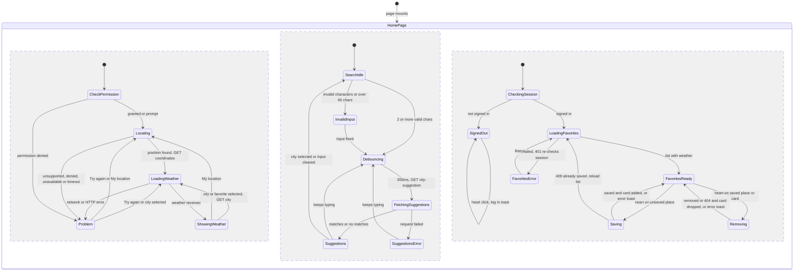

# Weather App — Frontend

Next.js 16 (App Router) · React 19 · Tailwind CSS 4 · axios. The app calls the backend at `NEXT_PUBLIC_API_BASE_URL`, sending cookies with every request (`withCredentials`).

```bash
npm install
npm run dev   # http://localhost:3000
```

## Home Page Flow

`src/app/(main)/page.js` renders `component/home/HomePage.jsx`.

- **Initial load:** checks the geolocation permission. If it is denied, a "Location access is off" panel is shown. Otherwise the page asks for the position (10s timeout, accepts one up to 10 min old), rounds it to 2 decimals and calls `GET /api/weather/coordinates`.
- **Weather display:** current conditions, hourly and 5-day forecast, and details. The background theme follows the current condition.
- **City search:** `CitySearch` validates input locally (2–60 chars, letters only), waits 300ms after typing stops, then calls `GET /api/weather/city-suggestion`. Picking a suggestion (click or Enter) calls `GET /api/weather/city`.
- **My location:** this button runs the geolocation flow again.
- **Latest request wins:** every new weather load aborts the previous request and ignores late responses.
- **Favorites (signed in only):**
  - Loaded with `GET /api/weather/get-user-favorite-location` once the session is confirmed. Each favorite includes its weather.
  - The heart saves (`POST`) or removes (`DELETE`) the shown place.
  - Selecting a card loads that city through the city flow.
  - When signed out, the heart shows a "log in" toast and the section shows a Login link.
- **Loading:** a skeleton on first load. While a new place loads over existing weather, the content dims and a progress bar shows.
- **Weather errors:** a full panel when no weather is shown yet, or a dismissible inline alert above the previous weather. Both show a Retry button that repeats the failed action (there is no Retry when the browser has no geolocation).
- **Favorite errors:** shown as toasts.
  - `409` on save reloads the list.
  - `404` on remove drops the card.
  - `401` re-checks the session.
- **Request handling:** protected requests refresh the access token once on `401`. `POST` and `DELETE` requests first fetch a CSRF token and retry once on `403`.



The three regions run in parallel: **weather**, **city search** and **favorites**. Selecting a city or a favorite card moves the weather region to `LoadingWeather`.
